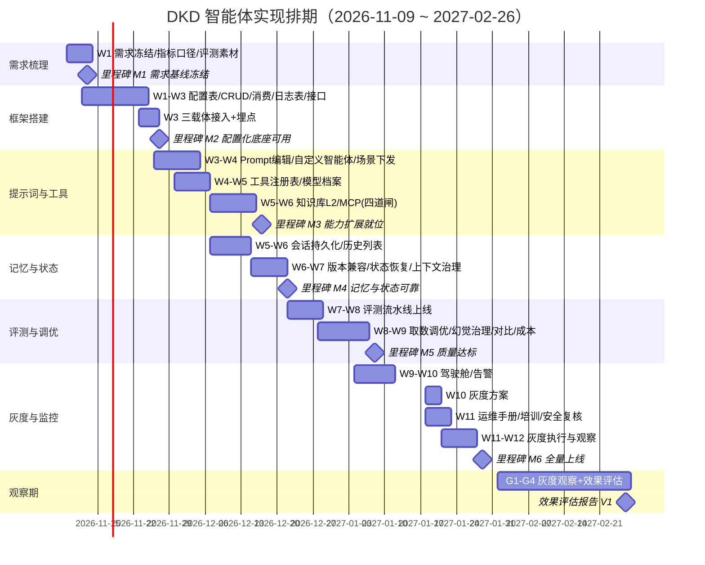

# DKD 智能体（Agent）实现详细计划表

> 日期：2026-11-03 · 版本：V1（基于原型画布 10 屏 + 《智能体配置化方案》 + 《能力缺口与补齐建议》 + 旧《DKD智能体接入项目排期计划》）
> 基准日：**2026-11-09（周一）起排**，总周期 **12 周开发 + 4 周灰度观察**（至 2027-02-26 出效果评估初版）

---

## 〇、已有生成物盘点与缺失假设（先读这节）

### 已作为输入的生成物
| 生成物 | 状态 | 用途 |
| --- | --- | --- |
| 原型画布（10 屏：S1~S4 配置管理、S6 日志、S7 驾驶舱、S11 知识库、S12 MCP、S13 会话列表、S14 模型档案） | ✅ 已完成 | 页面信息架构与交互口径 |
| 《智能体配置化方案-2026-11-03.md》 | ✅ 已完成（含 5 个待拍板问题） | 数据模型、校验、接入点、回落策略 |
| 《智能体能力缺口与补齐建议-2026-11-03.md》 | ✅ 已完成 | P0/P1/P2 范围与分期 |
| 旧《DKD智能体接入项目排期计划.md》 | ✅ 在用（09-21~12-25） | 三智能体主体建设排期与里程碑口径 |
| 三端代码实查结论（dkd-agent / dkd-parent / dkd-vue） | ✅ 已完成 | 接入点、护栏、测试基线（pytest 538 用例） |

### 缺失生成物 → 以下按假设先行（需确认）
| # | 缺失项 | 本计划采用的假设 |
| --- | --- | --- |
| A1 | **正式 PRD** | 以原型画布 + 配置化方案 §0~§6 作为需求基线，本文档即为需求冻结版；需求变更走变更单 |
| A2 | **接口文档** | 按配置化方案 §5.1/§6 的路径与权限点先行定义，开发时以 OpenAPI/Swagger 注解同步产出，不单独前置编写 |
| A3 | **测试用例文档** | 沿用 pytest 538 用例为回归基线，新增用例随任务交付（每任务行内写明验收标准），不单独出用例文档 |
| A4 | **业务/数据流程图** | 调用链路以配置化方案 §0.1 总图为准（dkd-vue → 网关 → Python → 图 → 工具 → 回调 Java），不另画 BPMN |
| A5 | **人力与投入** | Python 后端 1 人 + Java 后端 1 人 + 前端 0.5 人 + 产品/测试合计 0.5 人；无并行第二梯队 |
| A6 | **旧排期交付状态** | 假设三智能体主体（补货/诊断/助手闭环 + 观测 + 护栏）按旧排期于 W7 前后已交付并稳定运行（缺口文档「已落地」结论）；若实际延期，本计划各阶段顺延相同周数 |
| A7 | **预算与配额** | 沿用现有 token 日限额（429 限流）与单模型单密钥；模型档案页只做"可配可测"，不引入新供应商采购 |
| A8 | **知识库数据** | 维修工单仅 5 条且描述约 4 字（FIX-22），案例库 L3 不达标 → 本计划只做文档语料层 L2，L3 显示"未启用·数据未达标" |

---

## 一、分阶段任务计划表

> 周次定义：W1=11-09~11-13，W2=11-16~11-20，……W12=01-25~01-29；灰度观察期 G1~G4=2027-02-01~02-26。
> 优先级：P0=必须做否则无法运营；P1=规模化必需；P2=锦上添花可裁剪。

### 阶段 1 · 需求与场景梳理（W1）

| 任务名称 | 任务说明 | 前置依赖 | 优先级 | 开始/结束 | 里程碑与交付物 |
| --- | --- | --- | --- | --- | --- |
| 1-1 方案拍板会 | 闭环配置化方案 5 个待拍板问题（chat 载体先行、agent_log 新表 vs 复用、NULL 语义、内置可否停用、抽屉场景下发时机），未决项按推荐默认值先行 | 无 | **P0** | W1 周一 | 决策纪要（本文档 §五 汇总回填） |
| 1-2 需求冻结 | 冻结本期范围：P0=配置台+日志页+会话列表+降级可感知；P1=驾驶舱+工具中心+模型档案+Prompt 评测；P2=知识库 L2+MCP；明确裁剪顺序 | 1-1 | **P0** | W1 周一~周二 | 需求冻结清单（含原型 10 屏 ↔ 需求项映射表） |
| 1-3 指标口径定义 | 定义效果度量口径：采纳率 / 调整率 / 跳过率、LLM 校准率与降级率、取数准确率、单次运行 token 成本、失败运行率；明确样本量标注规则（n<100 不作对外口径） | 1-2 | **P0** | W1 周二~周三 | 指标字典 V1（驾驶舱 S7 与评测共用的唯一口径） |
| 1-4 评测素材采集 | 采集 50~100 条真实取数问题 + 期望结果（复用旧排期 3-2 评测集思路），另采 30 条场景问答样本 | 1-2 | **P0** | W1 周三~周五 | 评测集 V0 入库可复跑，基线准确率记录 |
| 1-5 数据依赖确认 | 知识库 L2 语料清单（厂商手册/故障码表/运营 SOP）收集与授权确认；确认 L3 案例库数据不达标结论 | 1-2 | P2 | W1 周三~周五 | 语料清单 + 授权记录；L3 挂起说明 |
| **1-6 M1 里程碑** | **需求基线冻结** | 全部 | — | **W1 周五** | 需求冻结清单、指标字典、评测集 V0、决策纪要 |

### 阶段 2 · 技术选型与框架搭建（W1~W3）

| 任务名称 | 任务说明 | 前置依赖 | 优先级 | 开始/结束 | 里程碑与交付物 |
| --- | --- | --- | --- | --- | --- |
| 2-1 配置表落地 | `agent_config` + `agent_config_history` DDL（UK code、版本化快照）；**seed 脚本 = 从现有代码常量逐字导出**（含 prompt 原文），未修改前行为与现状完全相同 | 1-2 | **P0** | W1 周四~W2 周一 | DDL + seed 脚本 + seed 回读比对报告（与常量逐字一致） |
| 2-2 Java CRUD | AgentConfigController（/manage/agent/config/**，不经网关）+ 权限点 manage:agentConfig:* + 乐观锁（version）+ @Log 审计；AgentLogController 只读 | 2-1 | **P0** | W2 周一~周三 | 接口联调通过；409 冲突返回 {field→msg} 结构 |
| 2-3 Python 配置消费 | config_store.py：TTL 30s 缓存 + 版本比对 + POST /agents/config/reload 失效 + 三重回落（无记录/解析失败/超范围→代码默认+WARN）+ 总开关 DKD_AGENT_CONFIG_FROM_DB | 2-1 | **P0** | W2 周二~周四 | test_config_store.py：「DB 关/空/损坏→行为与现状一致」全绿 |
| 2-4 日志表与采集 | agent_log 表 + 自定义 logging.Handler（级别≥INFO，带 request_id/run_id/conversation_id 上下文，异步批量写，只增不删）；30 天定时清理 | 1-1(日志方案拍板) | **P0** | W2 周三~周五 | 压测下无阻塞主流程；索引（create_time/request_id/level+create_time）就位 |
| 2-5 会话读接口 | Java 网关新增 /agent/conversations 只读列表（复用现有 agent_conversation/agent_message，含消息数/工具调用数/令牌/状态聚合） | 2-2 | **P0** | W2 周四~W3 周一 | 接口文档（Swagger 自动产出）；分页与时间范围强制限制 |
| 2-6 前端框架与骨架 | 菜单 9011/9017（sys_menu）+ 路由 + api/manage/agentConfig.js、agentLog.js、agentConversation.js + 三页骨架（列表/日志/会话，沿用 Element Plus 三态规范） | 2-2,2-5 | **P0** | W2 周五~W3 周二 | 三个空页面可走通权限与路由 |
| 2-7 配置生效接入三载体 | chat：scene 校验放宽+工具子集注入+prompt overrides；restock：prompt 与阈值改 config 取值；fault：窗口/置信度/清单配置化；llm.py 参数注入（不传=现状） | 2-3 | **P0** | W3 周一~周四 | 「配置值=默认常量时 prompt 与硬编码逐字相同」回归断言全绿；pytest 538 全绿 |
| 2-8 运行侧埋点 | 每次运行写 agent_run.config_version（补上现有空钩子） | 2-3,2-7 | **P0** | W3 周三~周四 | 审计页可按版本回放 |
| **2-9 M2 里程碑** | **配置化底座可用**：三智能体配置可视化+可调+可回滚，未配置行为=现状 | 2-1~2-8 | — | **W3 周五** | 配置台四屏（S1~S4）联调通过 + 回归全绿 + 演示录屏 |

### 阶段 3 · 提示词与工具/函数调用（W3~W6）

| 任务名称 | 任务说明 | 前置依赖 | 优先级 | 开始/结束 | 里程碑与交付物 |
| --- | --- | --- | --- | --- | --- |
| 3-1 Prompt 编辑与校验 | PromptEditor：字数 100~8000、白名单占位符校验（chat:{focus}{tool_list}{window_days}；restock:{fmin}{fmax}{data}）、恢复默认、版本 diff 视图 | 2-9 | **P0** | W3 周五~W4 周二 | 占位符未知值被前后端双重拦截 |
| 3-2 自定义智能体（chat 载体） | 新增抽屉 S4：注册场景码（≥101 自动分配）+ 工具子集（受 chat 白名单约束）+ 角色设定；启用后出现在助手抽屉场景列表 | 2-9 | **P0** | W4 周一~周四 | 端到端：新建→启用→抽屉可见→对话走通→留痕带 config_version |
| 3-3 场景后端下发 | /agent/status 扩展返回 agents[]；前端 SCENES 优先取下发、失败回落现有硬编码 3 项（灰度友好） | 3-2 | **P0** | W4 周四~周五 | 断网/接口失败时抽屉仍可用（回落验证） |
| 3-4 工具注册表 | agent_tool 表（本地工具与 MCP 同表）：code/scope/read_only/开关/超时/行数上限；启动校验「库内 code 必须能映射到代码」，找不到拒绝启动 | 2-9 | P1 | W4 周三~W5 周一 | 工具开关无需发版；试调仅放行 read_only=1 |
| 3-5 模型档案与连通测试 | agent_llm_profile（**密钥只存 env 变量名**）+ 连通性测试（复用 ping_llm，1 token 探测）+ 探测记录；页面对应 S14 | 3-4 | P1 | W5 周一~周三 | 探测记录含 HTTP 状态/延迟/结论；失败可保存为停用 |
| 3-6 知识库 L2 | 语料上传→切片→向量库→诊断/助手结论引用→**引用强制校验**（断言必须绑定相似度≥阈值片段，否则回退"仅列证据"模板）+ 检索测试页 + 命中归因 | 1-5,3-4 | P2 | W5 周二~W6 周三 | 检索测试报告；无引用断言的结论 100% 被回退（测试覆盖） |
| 3-7 MCP 工具接入 | 四道闸：只接 read_only=1（写一律拒绝仍回调 Java）、出网白名单+超时≤5s+返回≤200 行、密钥只存变量名、返回摘要化入留痕（复用 params_digest）；启动探测 | 3-4 | P2 | W5 周四~W6 周四 | 含写工具的 server 被拒接入（create_work_order 用例）；越权/超时/超行数用例全拦截 |
| **3-8 M3 里程碑** | **能力扩展就位**：自定义智能体 + 工具中心 + 模型档案可用，知识库 L2/MCP 按裁定进灰度或后置 | 3-1~3-7 | — | **W6 周四** | 端到端演示 + 新增护栏用例全绿 |

### 阶段 4 · 记忆与状态管理（W5~W7）

| 任务名称 | 任务说明 | 前置依赖 | 优先级 | 开始/结束 | 里程碑与交付物 |
| --- | --- | --- | --- | --- | --- |
| 4-1 会话持久化与续聊 | 助手抽屉 conversationId 落地持久化（刷新不丢）+ 历史会话面板（S13：筛选/分页/三态）+「查看详情」抽屉含消息时间线与工具调用入参摘要/行数/耗时 | 2-5 | **P0** | W5 周一~W6 周一（前端随骨架提前） | 刷新/重进后会话可恢复；追踪 ID 与日志页互通互跳 |
| 4-2 checkpoint 与配置版本兼容 | 会话恢复时按 agent_run.config_version 标注「本会话由 vX 配置生成」，配置回滚后旧会话不半途换 prompt（下一次调用才生效） | 2-8 | **P0** | W6 周一~周二 | 回滚后进行中会话行为可解释（测试用例） |
| 4-3 状态机恢复回归 | 服务重启后：补货 await_confirmation 中断-恢复仍可续；诊断多轮问诊状态不丢 | 2-9 | **P0** | W6 周二~周三 | 重启演练脚本 + 回归通过 |
| 4-4 数据保留与清理 | agent_log 30 天清理、会话保留策略（默认 90 天可配）、向量库重建（语料更新后增量重建不双写） | 2-4,3-6 | P1 | W6 周三~W7 周一 | 清理任务上线且有 dry-run 报告 |
| 4-5 上下文窗口治理 | 会话历史拼接的 token 预算控制：超预算滑动截断（保留 system + 最近 N 轮 + 工具结果摘要化），截断事件写日志 | 4-1 | **P0** | W7 周一~周二 | 长会话（50+ 轮）不超模型上下文；截断可观测 |
| **4-6 M4 里程碑** | **记忆与状态可靠** | 4-1~4-5 | — | **W7 周二** | 状态管理回归套件全绿 |

### 阶段 5 · 评测与调优（W7~W10）

| 任务名称 | 任务说明 | 前置依赖 | 优先级 | 开始/结束 | 里程碑与交付物 |
| --- | --- | --- | --- | --- | --- |
| 5-1 回归评测流水线 | 评测集（1-4）接入 CI：每次 prompt/参数版本保存前自动跑评测，报告附在版本历史（改前先跑=护栏） | 1-4,3-1 | **P0** | W7 周二~W8 周一 | 版本历史内可见评测报告；低于基线阻断保存（可强制但留痕） |
| 5-2 取数准确率调优 | 参数抽取/工具选型错误归因，迭代 prompt；目标：评测集准确率 ≥90%（对齐旧排期 3-3 口径） | 5-1 | **P0** | W8 周一~W9 周一 | 准确率报告（分场景/分错误类型） |
| 5-3 幻觉与引用治理 | 引用强制校验命中率统计；「仅列证据」回退率监控；对回退样本人工归因补语料或调阈值 | 3-6,5-1 | P1 | W8 周二~W9 周二 | 回退率 <15%；无断言输出为 0 |
| 5-4 Agent vs 规则对比 | 把 compare-1-14 脚本持续化：双跑埋点 → 驾驶舱对比卡（采纳率/建议偏差），样本量与口径随图标注 | 5-1 | P1 | W8 周三~W9 周三 | 对比报表（含 n 标注） |
| 5-5 成本与延迟调优 | 按场景/用户 token 分布分析 → 调 max_tokens/缓存策略；429 自助提示（已用/限额/重置时间） | 5-1 | P1 | W9 周一~W9 周四 | 单次运行平均成本下降 ≥20%（对基线） |
| 5-6 降级标记 | 补货建议行加 llm_calibrated 标记（LLM 超时退化为纯统计基线时前端可见「未校准」） | 2-9 | **P0** | W9 周二~周三 | 降级样本前端可见；驾驶舱告警条联动 |
| **5-7 M5 里程碑** | **质量达标**：取数准确率 ≥90%、评测护栏上线、成本达标 | 5-1~5-6 | — | **W9 周五** | 评测报告终版 + 调优记录 |

### 阶段 6 · 灰度上线与监控（W10~W12 + 观察期 G1~G4）

| 任务名称 | 任务说明 | 前置依赖 | 优先级 | 开始/结束 | 里程碑与交付物 |
| --- | --- | --- | --- | --- | --- |
| 6-1 驾驶舱上线 | S7 四卡（采纳/降级/成本/失败）+ 告警条 + 待我处理（含等待时长与超时阈值）+ Agent vs 规则对比 + 样本口径标注 | 5-4,5-6 | **P0** | W9 周三~W10 周二 | 驾驶舱上线；KPI 数据与指标字典一致 |
| 6-2 监控与告警 | ERROR 日志告警、连续失败告警、06:00 定时分析失败告警、模型探测失败告警（复用 agent_log 与探测记录）；值班与响应 SLA | 2-4,3-5 | **P0** | W10 周一~W10 周三 | 告警触达演练记录（人为注入故障验证） |
| 6-3 灰度方案 | 灰度顺序：① 总开关关闭验证纯代码路径 → ② 开配置但仅改非保护区参数 → ③ 放开 prompt 编辑（评测护栏下）→ ④ 自定义智能体试点 1 个场景 → ⑤ 知识库/MCP 试点；每步可独立回退 | M2~M5 | **P0** | W10 周三~W10 周五 | 灰度执行手册（含每步回退命令） |
| 6-4 灰度执行与观察 | 按 6-3 顺序逐级放量，每级观察 ≥3 个工作日；观察期 G1~G4 持续采集驾驶舱指标 | 6-3 | **P0** | W11~W12 / G1~G4（02-01~02-26） | 每级放量记录 + 回退演练一次（真实回退不演练则不算通过） |
| 6-5 运维手册与培训 | 运维手册（配置台操作/日志排查/告警处置/一键回落 DKD_AGENT_CONFIG_FROM_DB=false）；运营培训 1 场 | 6-2 | **P0** | W11 周一~W11 周三 | 手册 V1 + 培训签到与考核题 |
| 6-6 安全复核 | MCP 出网白名单复核、密钥全链路不落库核查（DB/日志/留痕三处扫描）、权限点矩阵复查、只读账号权限最小化复核 | 3-7 | **P0** | W11 周三~W11 周五 | 安全复核报告（含扫描证据） |
| **6-7 M6 里程碑** | **全量上线** | 6-1~6-6 | — | **W12 周五（01-29）** | 上线公告 + 遗留问题清单 |
| 6-8 效果评估 | 观察期结束后出评估初版：采纳率、降级率、缺货率/排单耗时对比（对齐旧排期 M5 口径） | 6-4 | P1 | G4 末（02-26） | 效果评估报告 V1 |

---

## 二、风险与坑

| # | 风险/坑 | 影响 | 预防措施 | 兜底方案 |
| --- | --- | --- | --- | --- |
| R1 | **上下文超长与截断**：长会话/大工具结果把历史拼爆窗口，模型静默截断导致"失忆"或报错 | 对话质量骤降、工具结果丢失、成本飙升 | 4-5 token 预算治理：滑动窗口 + 工具结果摘要化（≤200 行基础上再压缩）+ 截断事件写日志 | 截断告警进驾驶舱；超预算自动收敛为"仅最近 2 轮 + 结论摘要"模式 |
| R2 | **幻觉输出**：无依据的结论/编造数据（知识库引入后风险放大） | 错误建议进入人工确认流，损害信任；工单误派 | L1 结构化事实只走工具直查不进 RAG；引用强制校验（相似度≥阈值断言，否则回退"仅列证据"）；取数类输出必须带数据来源标记 | 回退模板 100% 覆盖无断言输出；评测集含"必须拒答"样本；幻觉样本入库供回归 |
| R3 | **工具调用失败与重试风暴**：DB 抖动/超时引发连环重试，放大故障 | 06:00 定时任务失败、SSE 卡死、错误日志刷屏 | 重试上限（max_retries≤5）+ 指数退避 + 每工具超时与行数护栏；失败写 agent_log 并进入告警 | LLM 超时→补货自动降级纯统计基线（llm_calibrated=0 可见）；连续失败→熔断该工具并回退无该工具的子集 |
| R4 | **并发超时**：SSE 长连接 + 定时分析 + 批量建单争抢连接池/线程 | 请求堆积、网关 504、用户侧"转圈" | 读超时 5s、分批执行、连接池与并发上限压测；SSE 心跳与前端超时提示 | 超时降级为同步摘要 + "结果稍后在工作台查看"；定时任务错峰与幂等重跑 |
| R5 | **Token 成本失控**：max_tokens 被配大、长会话无预算、评测流水线空转 | 账单超预算、429 限流影响业务 | 配置侧强制夹取（max_tokens 256~8192、>4096 提示成本）；温度/max_tokens NULL=模型默认；token 日限额（429）已有 | 429 明确提示（已用/限额/重置）；驾驶舱成本卡日环比告警；紧急时一键回落代码默认值 |
| R6 | **权限与数据安全**：MCP 出网绕过 sql_guard、密钥入库或被打进日志、越权读表 | 数据泄露、合规事故 | MCP 四道闸（只读/白名单/超时行数/摘要留痕）；密钥只存 env 变量名永不回显；表白名单 + 只读账号；写操作只能回调 Java（密钥+白名单+限流） | 启动探测失败拒绝启动；安全复核扫描（DB/日志/留痕三处查密钥）；出网白名单外地址直接熔断 |
| R7 | **评测标准不清晰**：无基线、口径漂移、"感觉变好了" | 调优无方向，prompt 改坏无人知 | 1-3 指标字典唯一口径；1-4 评测集入库；5-1 保存前强制跑评测并出报告；样本量 n<100 标注不作对外口径 | 低于基线阻断保存（可强制但强制动作本身留痕进 history） |
| R8 | **配置漂移与热更新竞态**：TTL 缓存旧值、Java 写后 Python 未失效、双写不一致 | 同一智能体不同实例行为不一致，排查困难 | 版本号比对而非盲信缓存；保存后异步 reload 失败仅 WARN 靠 TTL 兜底（≤30s 不一致窗口是接受值）；agent_run.config_version 留痕每次实际生效版本 | 不一致窗口内有日志可查；总开关一键回落纯代码路径 |
| R9 | **内置智能体行为被意外改变**：seed 不等于常量原文、回落链断裂 | 上线即改变现有业务行为（最严重的信任事故） | seed=常量逐字导出+比对报告；「配置=默认时 prompt 逐字相同」回归断言；pytest 538 全绿门槛；三重回落+数值夹取 | DKD_AGENT_CONFIG_FROM_DB=false 一键回到现状；版本回滚到 v1 |
| R10 | **会话/状态丢失**：前端刷新丢 conversationId、服务重启丢中断恢复 | 用户重复描述、人工确认流断裂 | 4-1 会话持久化；4-3 重启恢复回归；checkpoint 已有机制不动只验证 | 历史会话列表可检索找回；补货计划状态机落库可续 |
| R11 | **知识库数据质量**（FIX-22 工单仅 5 条、描述约 4 字） | 案例库做成垃圾进垃圾出，反噬 RAG 口碑 | L3 严格挂起（页面如实"未启用·数据未达标"）；先做文档语料 L2；数据达标标准：≥50 条结构化（现象/原因/处置/复发） | L2 检索测试页调阈值；命中不佳的语料下线不硬撑 |
| R12 | **灰度期双口径混乱**：新旧链路并存，指标对不上、问题定位分不清走哪条路 | 评估结论失真、回退决策迟疑 | 灰度每级独立观察 ≥3 天；agent_run.config_version + 链路标记可区分来源；对比报表分列不合并口径 | 每级可独立回退；灰度手册写明各级验证 checklist |
| R13 | **人力单点**（A5：每端 1 人） | 请假/并行任务直接顺延关键路径 | 关键任务文档化（本计划即交接文档）；M2 后 Python/Java 交叉 review | P2 项（知识库/MCP）整体可裁剪不阻塞 P0/P1 交付 |
| R14 | **评测/调优挤占开发**：W7~W9 同时背负新功能与调优 | 里程碑连环延期 | P2 项已排在 W5~W6 前置完成；W7 起无新页面开发，专注评测与驾驶舱 | 调优项设"达标即停"线（5-2 ≥90%、5-3 <15%、5-5 -20%），避免无限打磨 |

---

## 三、总体排期时间线（按周）

**周历一览（含假期折损）**

| 周次 | 日期 | 关键节点 |
| --- | --- | --- |
| W1 | 11-09~11-13 | **M1 需求基线冻结**（周五） |
| W2 | 11-16~11-20 | Java CRUD + Python 消费层 + agent_log |
| W3 | 11-23~11-27 | 三载体接入 + 埋点；**M2 配置化底座可用**（周五） |
| W4 | 11-30~12-04 | 自定义智能体 + 场景后端下发 + 工具注册表启动 |
| W5 | 12-07~12-11 | 模型档案 + 会话列表（前端） + 知识库 L2 启动 |
| W6 | 12-14~12-18 | 知识库/MCP 收尾；**M3 能力扩展就位**（周四） |
| W7 | 12-21~12-25 | 状态恢复回归 + 上下文治理；**M4 记忆与状态可靠**（周二） |
| W8 | 12-28~01-01 | 元旦假期折损约 1~2 工日；评测流水线 |
| W9 | 01-04~01-08 | 调优集中周；**M5 质量达标**（周五） |
| W10 | 01-11~01-15 | 驾驶舱 + 告警 + 灰度方案 |
| W11 | 01-18~01-22 | 运维手册/培训/安全复核；灰度执行开始 |
| W12 | 01-25~01-29 | **M6 全量上线**（周五） |
| G1~G4 | 02-01~02-26 | 灰度观察期；**02-26 效果评估报告 V1** |

> 与旧排期（09-21~12-25）的关系：旧排期负责三智能体主体建设，本计划负责其上的**运营与信任层 + 扩展能力**；两线在 W7~W8 有一段并行，若旧排期 M4/M5 里程碑延期，本计划 W7 之后的阶段按 A6 假设顺延相同周数。

---

## 四、与原型不一致的功能点（单独标注 ⚠）

| # | 原型内容 | 实现计划口径 | 差异说明 |
| --- | --- | --- | --- |
| ⚠1 | **S13 会话列表**提示文案写「agent_chat_session / agent_chat_message」新表 | 复用现有 `agent_conversation` / `agent_message` 表，不新增 | 原型命名与现库不一致；新增会话表会引入双写与迁移成本，计划采用复用方案（待确认，见 §五 Q6） |
| ⚠2 | **S14 模型档案**把温度/max_tokens 显示为模型级属性 | 配置化方案把它们定义在 `agent_config`（智能体级，NULL=模型默认）；模型档案只存连接信息（base_url/api_key_env/探测），不含采样参数 | 同一参数两处定义会产生"到底听谁的"冲突。建议：模型档案=连接与探测，智能体配置=采样参数覆写（待确认，见 §五 Q7） |
| ⚠3 | **S7 驾驶舱**含「立即重跑」入口（复用 /agents/restock/analyze 经网关暴露） | 配置化方案原则是"不动 fail-closed 网关白名单"，但重跑必须经网关暴露新路径 | 与网关不动原则冲突；需拍板：为重跑开白名单（推荐，加权限点+限流）或首版去掉该按钮 |
| ⚠4 | **S11 知识库**画布含案例库（L3）入口 | L3 挂起显示"未启用·数据未达标"，不做功能 | 原型即按此口径画的，此处仅强调：L3 界面存在但无后端，避免被误读为已排期 |
| ⚠5 | **S12 MCP**原型示意可同步 6 个只读工具 | 计划按 P2 排在 W5~W6，若人力吃紧整体可裁剪后移 | MCP 优先级低于 P0/P1；原型先行不代表进入首期必做范围 |
| ⚠6 | **S4 新增抽屉**支持选择任意载体（对话/补货/诊断） | 首版仅放开 chat 载体（场景码≥101）；restock/fault 自定义后置 P3 | 原型三选是终态展示；实现分期与原型全量形态不一致（待确认 Q1） |

---

## 五、需要你确认的假设与未定事项

**沿用配置化方案尚未拍板的 5 问（原样待决）：**
1. 自定义智能体是否**只放开 chat 载体**起步（推荐）？restock/fault 后置 P3？
2. 日志页走**新增 `agent_log` 表**（推荐 A）还是复用 `agent_run/step` 平铺（B）？
3. `agent_config` 的 temperature/max_tokens 是否接受 **NULL = 未设置（模型默认）**语义（推荐）？
4. 是否**允许停用内置智能体**（推荐：允许但必填原因 + 二次确认）？
5. 助手抽屉场景列表改**后端下发**（推荐，3-3 已排 W4）还是 P1 阶段保持前端硬编码？

**本计划新增待确认项：**
6. ⚠1：会话数据**复用现有表**（推荐）还是按原型字面新建 `agent_chat_session`？
7. ⚠2：采样参数（温度/max_tokens）归属——**智能体配置持有、模型档案只管连接**（推荐）？
8. ⚠3：驾驶舱「立即重跑」是否**为 /agents/restock/analyze 开网关白名单**（推荐，加权限点+限流）？
9. 人力假设 A5（每端 1 人）是否成立？不成立则 P2（知识库/MCP）建议整体移出本期。
10. 旧排期交付状态 A6：三智能体主体是否确按旧排期在 11 月中旬前稳定运行？若有延期，本计划从 W7 起顺延。
11. 灰度范围：自定义智能体试点选哪个场景/哪批用户？建议选「运营 SOP 问答」类低风险场景。
12. 效果评估口径：是否沿用旧排期 M5 的业务指标（缺货率降 30%+ / 排单耗时降 60%+）作为 G4 报告目标？

> 以上 1~5 未拍板期间，本计划各相关任务按"推荐值"预排（1-1 拍板会后回填），不影响 W1 开工。

---

## 六、执行进度（2026-11-03 起，M2 配置化底座）

> 分支：`feature/agent-config-console`（从 `develop` 切出；本地提交，**未 push/merge**）
> 实现契约：`docs/智能体配置化-实现契约-2026-11-03.md`（接口/字段/校验/回调的唯一口径）

### 6.1 本轮完成（代码级，门禁全绿）

| 任务 | 状态 | 交付物 | 验收证据 |
| --- | --- | --- | --- |
| 2-1 配置表落地 | ✅ | `docs/ddl/agent_config.sql`（`agent_config` / `agent_config_history` / `agent_log`）、`docs/ddl/agent_config_seed.sql`（脚本生成）、`docs/scripts/gen-agent-config-seed.py`、`dkd-agent/app/agent_defaults.py`（默认值唯一事实源） | `gen-agent-config-seed.py --check` exit 0；**2026-11-04 真库执行并回读 PASS**（3 行配置逐字一致 + 3 行 v1 快照）；Java 侧默认 prompt 资源 sha256 与 Python 常量一致 |
| 2-2 Java CRUD | ✅ | `AgentConfigController` + Service/Mapper(.xml) + DTO/VO + `AgentConfigDefaults`/`AgentConfigReloadNotifier`；权限点 `manage:agentConfig:*`；`@Log` + 乐观锁 409 + 版本快照 + 回滚 + meta + 异步 reload 通知；25 个单测 | `mvn -pl dkd-admin -am test`：191 tests / 0 failures / 0 errors（新增 25 例全绿） |
| 2-3 Python 配置消费 | ✅ | `app/config_store.py`（TTL 30s、三重回落、`get` 含停用行、`get_by_scene` 仅启用、夹取、reload 失效）、`/agents/config/reload`、`/agents/config/effective`、`DKD_AGENT_CONFIG_FROM_DB`/`TTL` 开关、`agent_config*` 只读表白名单 | `tests/test_config_store.py` 全绿；「DB 关/表缺失/损坏 → 行为与现状一致」用例覆盖 |
| 2-6 前端配置台 | ✅ | `api/manage/agentConfig.js`；`views/manage/agentConfig/`（列表 S1 + 详情/表单/参数/提示词/工具/版本历史 S2~S5）；`docs/ddl/agent_config_menu.sql`（9011~9016） | `npm run build:prod` exit 0；**2026-11-04 菜单 SQL 已在本机执行（6 行）**；浏览器手测待 Java/Redis 可用（见 §6.4） |
| 2-7 三载体接入 | ✅ | chat：scene 校验放宽 + 停用/未知场景 400 + prompt override + 每轮 `tools_provider` + LLM 参数注入；restock：参数/提示词/批量/LLM 参数；fault：窗口与置信度阈值；health 暴露配置开关 | 新增 `tests/test_config_carrier.py` 24 例；「配置=默认 ⇒ chat 四场景 + restock prompt 逐字相同」断言全绿；**真库 `source=db` 读取与停用/恢复 400→200 已冒烟** |
| 2-8 运行埋点 | ✅ | restock/fault `start_run` 写 `config_version`；回落/DB 关闭写 NULL（不编造） | 单测覆盖透传与回落；**2026-11-04 Python effective 真库读到 `version=1`** |
| 1-3 指标口径 / 1-4 评测素材 | ⏳ 未开工 | 属需求/数据任务，未在本轮代码范围内 | — |

**门禁（Lead 复跑，2026-11-03）**：
- `dkd-agent`：`pytest` **592 passed / 14 skipped**（exit 0）、`ruff check` / `ruff format --check` 全过；
- `dkd-parent`：`mvn -pl dkd-admin -am test` 191 tests / 0 failures / 0 errors；
- `dkd-vue`：`npm run build:prod` exit 0；
- seed：`gen-agent-config-seed.py --check` exit 0。

**2026-11-04 复验（同一提交，环境未变）**：
- 重跑上述四项门禁，结果一致（pytest 592 passed / 14 skipped；mvn 191/0/0；前端 exit 0；seed exit 0）；
- 新增 **HTTP 冒烟**（`python -m app`，临时端口 18090，`DKD_AGENT_OBS_ENABLED=0` 避免 DB 写）：
  在 `agent_config` 不可读时 `GET /agents/config/effective?code=restock` 返回 `source=default`
  （**三重回落真实生效**，不是只靠单测），`POST /agents/config/reload` 带服务间密钥返回 200
  `invalidated=true`；
- **真库 DDL+seed 回读**：同日获得本机执行权限后已执行并通过（`verify-agent-config-seed.py` PASS），
  随后 Python `effective` 读到 `source=db/version=1`——详见 §6.7。

### 6.2 与计划表的偏差（已记录在契约 §1/§2）

1. `system_prompt` 允许 NULL：fault 载体不调 LLM，强制必填会造出“配了但不生效”的字段；
2. chat 占位符白名单 = `{focus}{tool_list}{write_guidance}`（`_BASE_PROMPT` 里真实存在的三个），
   `{window_days}` 是代码追加行、不在模板内；
3. `agent_config` 的读取 SQL **不过滤 enabled**（只过滤 `del_flag`）：停用行必须能被 `get()` 看到，
   否则区分不了“没有配置（回落现状）”与“被停用（拒绝并给原因）”。

### 6.3 明确延后（不属 M2 交付，已在契约 §0 声明）

- **2-4 日志采集 Handler 与日志页**：`agent_log` 表已建，写入/查询下批；
- **2-5 会话列表接口与页面**：下批；
- 阶段 3 的自定义智能体 UI（3-2）、工具注册表（3-4）、模型档案（3-5）、知识库/MCP（3-6/3-7）。

### 6.4 未验证项 / 阻塞（如实登记，不当作已通过）

| # | 事项 | 现状 | 阻塞原因/下一步 |
| --- | --- | --- | --- |
| B1 | `agent_config.sql` + seed 真库执行与回读 | **已关闭（2026-11-04）**：本地 root 执行 DDL+seed+授权，`verify-agent-config-seed.py` **PASS**（3 行逐字一致 + v1 快照） | 生产仍需 DBA 评审后执行（脚本已登记执行记录） |
| B2 | Java CRUD ↔ Python reload 真联调 | **已关闭（2026-11-04 真环境）**：Redis 启动后 Java(8080)+Python(8090) 联调；`verify-m2-config-e2e.py` **PASS**，保存后 Python **立即**读到 v2（reload 生效） | 生产灰度按 §6.3 第①步复跑 |
| B3 | 前端配置台端到端（登录/权限/409） | **大部分关闭**：菜单 6 行已执行、`/getRouters` 含 `agentConfig` 路由、Vite dev 对 `index.vue` 编译返回 200；**浏览器可视手测未做**（无浏览器自动化环境） | 人工打开 `http://127.0.0.1:80` 走 S1~S5（新增→编辑→停用→回滚→双窗口 409） |
| B4 | Java meta 常量与 `agent_defaults.py` 漂移 | 未关闭（默认 prompt 已脚本导出+sha256 一致；models/tools/params 仍手工镜像） | 排期 5-1 加比对脚本；改默认值必须同时改两处 |
| B5 | 409 乐观锁端到端 | **已关闭**：真环境 `verify-m2-config-e2e.py` 断言 stale version → **HTTP 409**；另单测 + 真库事务验证 CAS affected=1/0 | — |
| B6 | 真库「配置=seed ⇒ 行为不变」 | **已关闭**：seed 逐字回读 PASS；Python `effective` 真库 `source=db/version=1`；停用/恢复、保存→reload→生效、回滚→清理全部真环境 PASS | 生产 DBA 执行后复跑回读脚本 |

### 6.5 下一步（按计划表顺序）

1. 人工浏览器走查前端配置台 S1~S5（`http://127.0.0.1:80`，admin 登录后菜单「AI 智能体 → 智能体配置」）；
2. 生产/测试环境由 DBA 评审后执行 `agent_config.sql` + `agent_config_seed.sql` +
   `create_agent_db_user.sql` 追加段 + `agent_config_menu.sql`（本机已执行并回读 PASS，见 §6.7）；
3. 启动 2-4（`agent_log` Handler + 日志页）与 2-5（会话列表），对应 W2~W3 剩余任务；
4. 按 1-1 ~ 1-4 补决策纪要与指标/评测集（本计划 W1 的文档类任务）。

### 6.7 2026-11-04 真库验证补记

> 说明：本节记录本轮在本机 `dkd` 库（MySQL 8.0.40）上**实际执行**的验证与证据；
> 未执行/未通过的项在 §6.4 单独登记，不混入“已通过”。

**已执行并通过**：
1. **建表 + seed + 授权 + 菜单**：`agent_config.sql`、`agent_config_seed.sql`、
   `create_agent_db_user.sql` 的 2026-11-03 追加授权段、`agent_config_menu.sql` 全部执行成功；
   库内状态：3 行配置（restock/fault/chat，version=1、enabled=1）、3 行 v1 历史快照、6 行菜单（9011~9016）。
2. **seed 回读**：`docs/scripts/verify-agent-config-seed.py` → **PASS**（3 行 `system_prompt`
   与 `agent_defaults.py` 逐字一致、params 归一化一致、均有 v1 快照）。
   期间修掉脚本自身两个缺陷（`int('restock')`、把 seed 的 version 与不含 version 的默认值比较），
   已随本次提交修复。
3. **只读账号权限**：`dkd_agent` 可 SELECT `agent_config`（回读依赖），
   `INSERT agent_config` 与 `DELETE agent_log` 均返回 **ERROR 1142**（两级授权生效）。
4. **Python 服务真库冒烟**（`python -m app`，临时端口 18090）：
   - `/health`：`config_from_db=true`；
   - `/agents/config/effective`：restock/fault/chat 均 `source=db`、`version=1`，
     prompt 为 UTF-8 字节长度 1329 / 0 / 2916（与 DB `CHAR_LENGTH` 625 / NULL / 1234 一致）；
   - `/agents/config/reload`：200 `invalidated=true`；
   - `/agent/chat`：scene=101 → 400、scene=5 → 422、scene=1 → 200 SSE（meta/delta/done）；
   - **停用内置 chat** → scene=1 返回 400；恢复 enabled=1 + reload → 200（finally 保证恢复，
     库内 `enabled` 已核对回 1）。
5. **Java 侧 SQL 语义（真库事务内验证，已回滚无残留）**：
   - 列表查询（`del_flag='0'` + 排序）返回 3 行，顺序 chat/restock/fault；按 id 查询正常；
   - 乐观锁 UPDATE：`version=1` 首次 affected=1（version→2），同一 stale 请求 affected=0；
   - history INSERT 的 JSON snapshot `JSON_VALID=1`；`params_json` 字符串写入可被
     `JSON_EXTRACT` 正确读出；`ROLLBACK` 后 version/change_note/params/history 计数均恢复。
6. 窗口/阈值等三载体行为等价的**单测层**证据不受影响（592 passed）。

**仍未验证（阻塞）**：
- Java 后端 HTTP 端到端（登录、`/manage/agent/config/**`、409 响应、保存后 reload 通知）：
  本机 Redis 不可用（`rediszt3` 服务停止且无法启动，Docker Desktop/WSL 均不可用），
  Java 登录链路依赖 Redis，无法在不改代码的前提下起服务；
- 前端浏览器手测（登录、菜单可见、409 双窗口）同样依赖上面的 Java 可登录环境。

**数据状态声明**：本轮除建表/seed/授权/菜单外，未持久化修改任何配置行
（停用测试已恢复；CAS/JSON 验证均在事务内 `ROLLBACK`；库内仍为 3 行 v1 + 3 行 history）。

**2026-11-04 09:43 真环境端到端（Redis/Java/Python 全部拉起后）**：
- 环境：Redis 3.2.100、Java 8080、Python 8090（`config_from_db=true`）、Vite dev :80、
  MySQL 8.0.40、PG17 checkpoint。
- **发现并修复一个真实缺陷**：`AgentConfigServiceImpl.fillIdentity` 编辑分支漏了
  `config.setId(dto.getId())`，mapper 的 CAS UPDATE `WHERE id = #{id} AND version = #{version}`
  因 id=null 恒 0 行 → **所有保存都被误报 409「配置已被他人更新」**。
  单测此前只断言 version、没断言 id，因此一直是假绿；已修复并补回归断言
  （`updateCaptor.getValue().getId() == 5`），`mvn -pl dkd-admin -am test` 191/0/0；
  后端按 `.run/RUNNING.md` 的镜像构建流程重建并重启加载修复。
- 新增 `docs/scripts/verify-m2-config-e2e.py` 并 **PASS**：列表 3 行 / 详情 / v1 历史 /
  `/getRouters` 含 `agentConfig` / stale version → **HTTP 409** / 过短 prompt → HTTP200+code400
  字段级且不落库 / 保存 → v2 / **Python 立即读到 v2（Java→Python reload 生效）** /
  回滚 → v3 且内容与 v1 逐字一致 / 清理恢复 v1、历史仅 [1]。
- e2e 脚本自带备份/恢复护栏（finally 按运行前备份恢复 + 删除本次 e2e 历史版本，直接 SQL 清理已在
  输出中明示）；库内最终仍为 3 行 v1 + 3 行 history，`verify-agent-config-seed.py` 再次 **PASS**。
- 前端：Vite dev 对 `/src/views/manage/agentConfig/index.vue` 返回 200（130KB 编译产物）、`/` 200；
  **浏览器可视手测未做**（§6.4 B3）。

### 6.6 决策记录

本轮按 §五 推荐值先行（Q1~Q8，见契约 §1），并新增两条有意偏差（§6.2）；
完整决策留痕见 `docs/决定记录.md` 2026-11-03 两条。

---

## 七、全量执行（2026-11-04 起，按用户要求「全部完成后统一验证」）

> 执行看板：`docs/智能体计划执行看板-2026-11-04.md`（每轮更新，逐任务状态/证据/阻塞）。
> 本文档 §六 记录 M2；§七起为 M3~M6 与阶段 1 文档的全量推进记录。

**方式**：继续在 `feature/agent-config-console` 分支开发，按 Batch A~F 推进（A=2-4/2-5+阶段1文档；
B=阶段3 P0/P1；C=阶段3 P2 知识库/MCP；D=阶段4；E=阶段5；F=阶段6），每批完成即本地 commit，
**不 push/merge**，最终统一交给用户验证。

**状态口径**（与看板一致）：✅ 有可复跑证据｜🟡 代码完成待联调/待人工确认｜⏳ 进行中｜⬜ 未开始｜
🧑 必须真人/真实数据/生产环境/时间观察（不可由 AI 代做完成）。

**明确不可代做的项**（会产出可执行手册/脚本，但完成状态标 🧑）：
1-4 真实评测样本采集、1-5 语料授权、3-6 L3 案例库数据、3-7 真实 MCP server 接入、
5-2 真实取数准确率达标（需真 LLM+评测集+成本）、6-4 灰度执行与 G1~G4 观察期、
6-5 运营培训、6-6 安全复核签字、6-7 生产上线、6-8 效果评估。

**Batch A（2-4/2-5 + 阶段 1 文档）完成（2026-11-04 10:15）**：
- **2-4 ✅**：Python `DbLogHandler`（有界队列/异步批量/失败不阻断；字段白名单防密钥落库）
  + Java `GET /manage/agent/log/list`（默认 24h、最长 30 天、pageSize≤200 拒绝）
  + 日志页 S6 + 菜单 9017；真机 Handler 写入 `agent_log` 5+ 行，Java 接口读到（total=5，
  keyword 过滤 total=4，pageSize=500 被拒）；30 天清理 SQL 模板已交付（定时执行属 4-4）。
- **2-5 🟡**：Java 会话列表/详情接口 + 页面 S13 + 菜单 9018/9019；
  真机 `agent_conversation`=0 行（存量 269 条 `agent_message` 无会话头）→ 空态/失败态已验，
  **成功态待 4-1 补会话写入**（不插测试数据，避免污染审计）。
- **1-1~1-5 ✅文档**：`docs/agent-decisions-2026-11-04.md`、`agent-requirements-freeze-2026-11-04.md`、
  `agent-metrics-dictionary.md`、`agent-eval-set-2026-11-04.md`（starter 仅 example-only）、
  `agent-knowledge-corpus-inventory.md`；真实样本/语料授权仍待外部（E-1/E-2）。
- 门禁：pytest 605 passed/14 skipped、ruff 全过、mvn 244/0/0、`npm run build:prod` exit 0。

**Batch B1（3-2 自定义 chat 智能体 + 3-3 场景下发）完成（2026-11-04 10:25）**：
- Python：`system_prompt` 支持 `tool_names_override`/`scene_label`，自定义场景追加固定安全 footer；
  `respond_with_llm` 从配置快照注入工具/角色名；新增 `GET /agent/agents`（仅 enabled chat 配置、
  不含 system_prompt、DB 不可用空数组）；20 个新单测（含内置 prompt 逐字不变回归）。
- Java：`/agent/status` 内部调用上游 `/agent/agents` 并透传 `data.agents`；上游失败只 WARN + 空数组，
  status 恒 200（不新增网关白名单）；8 个新单测。
- Vue：助手抽屉场景动态化（后端下发 + 硬编码 3 项回落；自定义 tab 通用欢迎语/快捷问题；停用回落）。
- **真环境 e2e**：创建 scene=101 自定义 chat 配置 → Python `/agent/agents`=[1,101]、
  Java `/agent/status.agents`=2 条 → 经 Java 网关 SSE `scene=101` 对话走通
  （mode=llm、done.model=deepseek-flash、119 帧/190 字）→ 留痕 1 message + 1 decision →
  测试配置/历史/消息/决策已清理（直接 SQL，输出明示）。
- 门禁：pytest **625 passed/14 skipped**、ruff 全过、mvn **252/0/0**、前端构建 exit 0。
- 未验：浏览器可见新 tab（E-3）；status 多一次上游调用（复用 120s 超时，建议后续独立短超时）。
